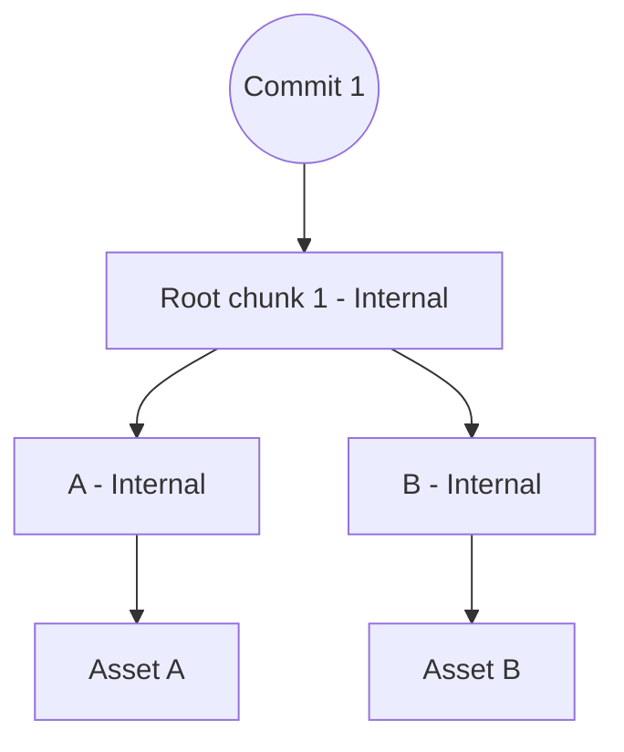
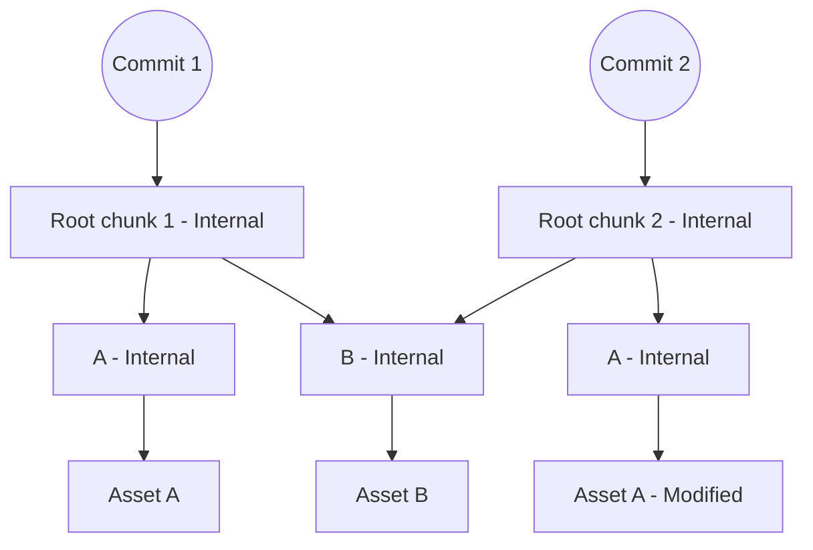

# Assets

To a user, an asset is some blob that is held in the asset drawer. Under the hood there are a few more mechanics at play to enable versioning, variants, and deduplication.

Firstly, versioning. Assets belong to repositories and those repositories have commits. An asset is always introduced via a commit. An update to an asset is really just a new asset under the same identification- that is- the old asset is still in the database. Looking up assets depends on knowing the commit where the asset is represented so that the right version can be given.

Next is variants. Some asset types may hold many variants. Consider textures with their lods (mipmaps). A texture asset will have multiple artifacts, one for each lod level, and it is up to the requested to ask for the appropriate artifacts for a given use case. This is useful for streaming in session data quickly. You can see a lower quality version fast and slowly stream in higher quality textures and meshes long after you've actually connected to a session.

Finally, deduplication. By sharing one database for many repositories, a files table can keep track of which files have already been saved to the database. This means that only the record for the file (its name, location, etc.) are duplicated when using it in multiple places. This is done by hashing the file using SHA256 and creating a mapping from hash to blob.

Assets are identified in three ways:

1. By numeric id; simply a number. The same assets that has been edited in a repository over multiple commits will have different ids for each commit it was modified within.

2. By path. This is a more dynamic way of referring to an asset and is typically not preferred as moving the asset can break the reference. Regardless there are use cases for such a reference. The formatting is undecided but will need to include the server, owner, repository, commit, and asset path. Something like `treb-buchet.cinebara.10:textures/cobblestone` for a commit id or `treb-buchet.cinebara.main.head:textures/cobblestone` for a dynamic reference to the asset on the latest available commit of branch "main".

3. By commit-stable id. A very useful and stable form which preserves the reference between commits. Quite like path, but unbound to the location of the asset within the commit referenced. Like method 2, you need to provide the relevant information about where to find the branch. Something like `treb-buchet.cinebara.main/head:d81abae1-9ced-46d4-98a9-95baf1247866`. Uuids are used for this identification. References may omit details that could be automatically filled, such as `local/d81abae1-9ced-46d4-98a9-95baf1247866` to refer to an asset within the currently checked out commit.

=== Reference format proposals

| Purpose              | Format                                                | Examples                                                                              |
| -------------------- | ----------------------------------------------------- | ------------------------------------------------------------------------------------- |
| Commit (absolute)    | `commit:{commit-id}`                                  | `commit:00000000-0000-0000-0000-000000000000`                                         |
| Commit (adaptive)    | `branch:{branch}:{marker}[<{parent offset}]`          | `branch:main:head<3` / `branch:spooky:tail`                                           |
| Asset (uuid)         | `{asset-uuid}`                                        | `00000000-0000-0000-0000-000000000000`                                                |
| Asset (path)         | `{path}`                                              | `textures/cobblestone`                                                                |
| Global URI           | `global://{location}/{owner}/{repo}/{commit}/{asset}` | `global://assets.cinebara.com/treb/big-project/branch:main:head/textures/cobblestone` |
| Commit local URI     | `commit://{asset}`                                    | `commit://textures/cobblestone`                                                       |
| Repository local URI | `repo://{commit}/{asset}`                             | `repo://branch:main:head/00000000-0000-0000-0000-000000000000`                        |

===

## Asset Repositories

When you open the asset drawer you are presented with your local repository. The local repository stores your personal assets and does not belong to any server. Only the local user can access this repository.

Repositories are distinct scopes for assets to live in. Assets may have contents which refer to other assets within the same repository. Assets may not directly reference assets outside of their repository.

## Referencing assets from another repo

To use assets that belong to another repository, a linked asset is used. A linked asset is a local copy of an asset from another repo with a bit of metadata about where it was originally loaded from. Linked assets cannot be modified. However, you may unlink the asset to make it an owned copy which is free for mutation. Unlinking will preserve links for referenced assets contained within the unlinked asset, so a recursive unlink is also provided to make a completely local copy.

## Dependencies

A repository may depend on other repositories, quite like github submodules. The entire referenced repository should probably be copied to ensure that each repo can stand on its own, but that may be optional.

## Version control

Local changes to a repository are tracked for committing later. A repository hosted on a different machine will not be mutated by local changes until a commit occurs.

Creating a commit in a repository takes a snapshot of the state of the repo, or at least the changes since the last snapshot. These commits are uniquely identifyable and a commit must be referenced by repos that intend to use dependencies.

Some assets may support even more granular version control. A Stage, for example, records every change that is made to it and each time it is saved, a new artifact is made for the stage asset that preserves these "diffs".

Modifying and saving an asset creates another artifact for it. This could be problematic for large assets being modified, so we may want to consider "live artifacts" allowing for drop-in replacements of artifacts and reducing duplication. To be discussed.

## Asset Servers

Repositories are made available through an "Asset Server". It is a database holding many repositories which are made available through some API. In the case of a persistent remote server, that is probably HTTP, but in the case of a user-hosted session, it is via the same RTC connections used for session communication.

## Implementation steps

- [x] Creating a repo
- [-] Local changes
- [ ] Hosting a repo in a session
- [ ] Hosting a repo persistently
- [ ] Using a persistent repo in a session
- [ ] Making commits in a repo
- [ ] Restoring to previous commits
- [ ] Repo branches
- [ ] Hidden assets for property stored assets and such

## VCS implementation

The database holds tables for the specific purpose of version control. This includes these tables:

- Repositories
- Branches
- Commits
- Chunks

There are also some relational tables which I'm not showing in this list, but they are typical db many-to-one relational nonsense.

### Chunks

Chunks are used as the structure of the VCS. There are two types of chunk: internal and leaf. These types are not explicit, but rather inferred from the available data. If a chunk has child chunks then it is internal, and if the chunk has "rows" then it is a leaf.
The purpose of this architecture is to allow for reusing entire sub-trees when representing the structure of a commit.

To illustrate how internal chunks are reused, consider this tree:

Notice that "Commit 1" holds a reference to "Root chunk 1 - Internal". If a query is ever made that refers to "Commit 1", then we now know which chunk to begin traversal from to find the asset requested.
How exactly the traversal works will come later.

Now suppose that another commit is made which modified Asset A but not Asset B. We need to rebuild the ancestor chunks of Asset A so that we can point to the updated asset, but the unchanged B subtree may be reused.

> The amount of deduplicated structure scales linearly with the size of the repository. 

Notice that we did not remove Asset A. This is what makes this a VCS, you never discard older commit structures and so you may always checkout a prior commit.

#### Finding an asset from root to leaf

Each child of an internal chunk stores is maximum represented asset UUID. Children are ordered by this maximum. Traversal follows the first child whose maximum id is at least the UUID we're trying to find.
This repeats until we find a leaf. The leaf contains multiple represented asset rows, so one last lookup is done to find the row with the UUID we're searching for. 

==- How UUIDs are compared

UUIDs are compared by converting them to strings and then comparing each character from left to right. 

===

### Working state

Working in a session does not modify a repository directly, rather, changes to the repository are accumulated in a "working state". This working state is what the session actually serves to clients looking for assets.
Suppose Treb is in a session and he adds a new texture "Cobblestone". The texture is not yet added to the repository, but it is remembered in the working state. Peers requesting "Cobblestone" now go through the working state first and find Trebs texture.
If an asset is not found in the working state then the request is passed through to the repository.

Once Treb is satisfied with the working state he can send his changes to the asset server which will create a new commit. Cobblestone is now actually represented in his repository.

## FAQ

=== Why not store files in folders and use git?

By using our own VCS we can deduplicate asset blobs. Films may have many repositories for organizing their assets, and sharing assets between them becomes much cheaper on storage if they can reuse blobs.
Additionally, all of a repositories historical versions of the repository are available for immediate querying. This means that asset references can choose to refer to an older version of a given asset from within the same repository.

===

## Open Questions

> **Q**: Can you commit versions of assets without committing the entire repo?
>
> **A**: Assets may have specific commit-like handling, but it is not equivalent to a repo commit.

> **Q**: When modifying an asset and saving, does it automatically save a new artifact or replace the existing one?
>
> **A**: It removes the old one and adds the new one with the same id.

> **Q**: Are repos replicated locally when hosting one from a server?
>
> **A**: You don't replicate it. Repo diffs will accumulate and be applied on commit.

> **Q**: How does hosting a repo on a server work in comparison to hosting one locally for a session?
>
> **A**: Diffs remove the need to answer this.

> **Q**: Can multiple sessions be open for the same repo at once?
>
> **A**: Yes, because of the diffs there isn't direct mutation competition.

> **Q**: How do linked assets work? Do you link entire projects as "sub-projects"?

> **Q**: Do we have dependencies? A project could depend on another project from another repo / asset server. This could be how asset linking works.
>
> **A**: Nested repositories will act like dependencies with a location like any asset. It is effectively an asset.

> **Q**: How do permissions / ownership work?
>
> **A**: Access to a repo requires a key. The key can be shared to clients even if they are not logged in. Later, accounts can provide the keys automatically.

> **Q**: Who can use your repo as a nested repo? Is it a public / private system or more flexible?
>
> **A**: Sub-repos are shared to specific users or made completely public. A public repo with a private nested repo exposes the nested repo. How to properly handle this is under discussion.

> **Q**: How do we represent assets which are not saved in a repo but still used in a stage? For example, a generated asset, like a node which outputs a procedural mesh. Or just an asset which is used in a property but is not saved to the repo separately.
>
> **A**: Assets stored in properties become sub-assets of the thing the properties are on. Assets provided through pushers are not saved, so all is good.
